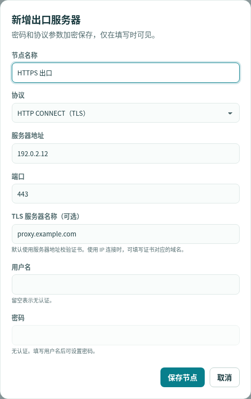

# 上游账号独立出口

在“出口服务器”添加节点后，可在 Codex、Antigravity、Anthropic 的账号表格选择出口。多个账号可共用同一节点。“继承全局出口”沿用 `EGRESS_MODE=direct/relay/shadowsocks`。

| 协议 | 节点配置 |
|---|---|
| HTTP CONNECT、HTTP CONNECT（TLS） | 服务器、端口，可选用户名和密码。TLS 模式使用系统信任根校验代理证书。使用 IP 连接时，可填写证书域名作为 TLS 服务器名称。两种模式均承载 TCP 隧道。 |
| Shadowsocks | 服务器、端口、密码及加密方式。支持 `aes-128-gcm`、`aes-256-gcm`、`chacha20-ietf-poly1305`、`2022-blake3-aes-128-gcm`。 |
| SOCKS5 | 服务器、端口，可选 RFC 1929 用户名和密码，各不超过 255 字节。 |
| SSR、VMess、VLESS、Snell、Trojan、Hysteria、Hysteria2、WireGuard、TUIC、ShadowQUIC、GOST Relay、SSH、Mieru、AnyTLS、Sudoku、MASQUE、TrustTunnel、OpenVPN | 用“快速导入”粘贴分享链接或 Mihomo 节点 JSON；也可以手动填写服务器和端口，在“协议参数”填写该协议的 JSON 对象。编辑器给出示例和可用字段。 |
| Tailscale、ZeroTier、EasyTier | Owner 在平台节点中配置组网参数。这三种协议通过组网发现对端，成员节点沿用公网 IPv4 单一地址约束。 |

### HTTP CONNECT 与 TLS

例如，代理监听 `192.0.2.12:443`，证书签给 `proxy.example.com`，选择 **HTTP CONNECT（TLS）**，分别填写 IP、端口、TLS 服务器名称即可。若直接填写证书对应的域名，可省略 TLS 服务器名称。运行时先验证代理证书，再发送 CONNECT 和可选的 Basic 认证。普通 HTTP 模式会在到代理的链路上明文发送这些信息。用户名留空表示匿名访问。设置认证时用户名最长 255 字节，密码最长 4096 字节。



### 快速导入

新增节点对话框顶部的“快速导入”接受一条分享链接或一个 Mihomo 节点 JSON，在页面内解析后填入表单，核对后再保存；原始链接不会单独上传。

- 分享链接：`vless://`、`vmess://`（v2rayN Base64 JSON 或 URI 形式）、`trojan://`、`ss://`（SIP002 与旧式 Base64）、`hysteria2://` / `hy2://`、`tuic://`、`anytls://`、`socks5://`、`http(s)://`。传输方式支持 tcp、ws、grpc、h2、http 与 xhttp，安全类型支持 tls 与 reality。
- 节点 JSON：与 Clash.Meta / Mihomo 配置中的单个节点相同，例如 `{"name":"jp","type":"vless","server":"203.0.113.7","port":443,"uuid":"…","tls":true}`。`name`、`type`、`server`、`port`、`udp` 填入对应表单项，其余字段作为协议参数。没有 `type` 的对象视为当前协议的参数。
- 不在白名单内的参数（如 `skip-cert-verify`、`allowInsecure`、`spider-x`）会列出并忽略。若忽略的是传输配置（`network` 或 `*-opts`），导入直接报错，避免保存一个连不上的节点。SS 插件、端口跳跃、httpupgrade 传输和不支持的 SS 加密方式同样报错。
- 成员节点须使用公网 IPv4，或 Owner 允许的域名。链接里的服务器是域名时，导入结果会提示：保存时才检查该域名是否被允许，不允许时请改成服务器 IP。

### 成员节点域名白名单

Owner 在“出口服务器”页的“成员节点域名白名单”里每行填写一个域名，保存时需要近期验证：

- `proxy.example.com` 只允许这一个域名；`*.example.com` 允许它的全部子域名，不含 `example.com` 本身。
- 白名单不限端口，最多 256 条；不接受协议、端口、路径、IP、`localhost`、`.local`、`.internal` 等内部后缀。
- 白名单只有 Owner 能读取（`GET/PUT /admin/egress-allowed-domains`）。成员页面不显示白名单，成员保存节点时才得知该域名是否被允许。
- 仍有成员节点使用的域名不能移除，保存会返回 409 并列出这些域名；先让成员修改或删除节点，或由 Owner 在“租户供应商”中删除未绑定的节点。
- 域名在出口服务拨号时解析。只加入你能控制或信任的域名，见[威胁模型](threat-model.md)。

### 协议参数

协议参数是 Mihomo（Clash.Meta）节点字段组成的 JSON 对象，不含 `name`、`type`、`server`、`port`。编辑器按协议显示示例，可一键“填入示例”，并在“格式说明与可用字段”中列出该协议接受的字段。保存前页面先检查字段，含有不支持的字段时直接指出字段名。

例如，Trojan 的参数可以是 `{"password":"示例密码","sni":"proxy.example.com"}`。名称、协议、地址和端口由表单单独填写。API 的 `options` 接受一个最多 24 KiB 的 JSON 对象。SSH 私钥使用内联 PEM；WireGuard 的单个对端使用表单的服务器和端口。运行时为组网节点的每个生效版本分配独立的 tmpfs 状态目录。容器重建后应使用可重新入网的凭据。

Gateway 用节点标识和协议绑定加密参数。列表只返回是否设置过参数。编辑同一协议时留空可保留参数，切换协议需重新填写。保存专属参数前，运行时用本机锁定的 Mihomo 单独检查配置，检查通过后才写入数据库。远端凭据和链路可用性由“测试连通性”验证。

### SOCKS5 节点

- SOCKS5 本身不加密。用户名、密码和目标域名（如 `chatgpt.com:443`）在运行时到
  SOCKS5 服务器之间的链路上可见；模型流量本身仍是端到端 TLS。请只在可信网络或
  已加密的隧道中使用 SOCKS5 节点，并为它单独设置凭据。
- 不支持 SOCKS5 over TLS，也不读取节点中的 URL；server 与 SS 节点一样只能是 IPv4 或
  小写域名。
- 切换协议（SS ↔ SOCKS5），或给无认证的 SOCKS5 节点加上用户名时，必须重新填写
  密码，旧协议的密码不会沿用。清空用户名即改为无认证，并删除已保存的密码。
- 连通性测试与 SS 节点相同：只有经该节点与目标完成 TLS 握手才算连通。地址不可达、
  认证失败、或 SOCKS5 服务器拒绝连接目标都显示为 `handshake_failed`。

`2022-blake3-aes-128-gcm` 的“密码”是服务端配置的预共享密钥：标准 Base64（带 `=`
填充）编码的 16 字节随机值，例如 `openssl rand -base64 16` 的输出；服务端启用多用户
身份头（EIH）时，按服务端给出的顺序用英文冒号连接多个密钥。网页、Gateway 和出口
运行时都会检查格式，格式错误的密钥不会保存，也不会下发：Mihomo 遇到一个无效密钥
会拒绝整份配置，导致所有节点的变更都无法应用。把已有节点切换为该加密方式时须重新
填写密钥；留空保存时，Gateway 先解密现有密码并确认它是有效密钥，且只在节点仍是
该版本时写入。SS2022 要求客户端与服务端时钟误差在 30 秒内。

## 生效与故障

保存先持久化，再应用到出口运行时。页面分别显示配置保存和运行时应用状态；应用
失败不会把账号改为继承全局出口。绑定的节点无法连接或密码错误时，该账号的操作
失败；已有调度器仍可以按原规则尝试另一个有权限的账号，并使用该账号自己的出口。
解除绑定后恢复全局出口；删除前需要先解除引用。

CPA 插件模式下，每个凭证都写有显式出口（未绑定的账号写全局出口地址），CPA 自身不配置
任何代理，出口失败时只会失败，不会改走全局出口或直连；详见
[兼容层升级规程](compatibility-upgrades.md#账号独立出口)。

推理、额度查询、模型目录、诊断和凭据刷新均使用账号绑定。OAuth 新增/重新授权及
凭据导入先选择出口，使用持久化的短期登记关联验证过程与最终账号，避免先用默认
出口访问 provider 再补绑定。配置变化影响后续操作，已建立的流式连接继续完成。

## 连通性测试

“出口服务器”页面的每个节点都有“测试连通性”按钮，“全部测试”会依次测试所有
已应用的节点（同时最多 3 个）。测试目标可选：

| 选项 | 目标 |
|---|---|
| Codex（默认） | `chatgpt.com:443` |
| Antigravity | `cloudcode-pa.googleapis.com:443` |
| Anthropic | `api.anthropic.com:443` |

测试由出口运行时完成：通过该节点当前已应用版本的本地监听发起 CONNECT，再与目标
完成 TLS 握手并校验证书。Mihomo 在连接 SS 服务端之前就会回应 CONNECT，所以只有
握手成功才能说明节点地址和端口可达、加密方式与密码正确、且该出口能访问目标。
测试不发送 HTTP 请求或模型请求，不消耗额度，不经过 Squid，也不使用任何账号路由
凭据；运行时仍只连接本机 Mihomo 监听，不直连目标。

结果只在当前页面显示，不写数据库，节点修改后需重新测试。结果码如下：

| 结果码 | 含义 |
|---|---|
| `ok` | 连通正常，显示从发起到握手完成的耗时 |
| `handshake_failed` | 握手失败：节点不可达、加密方式或密码错误，或该出口无法访问目标 |
| `timeout` | 10 秒内未完成握手 |
| `certificate_invalid` | 目标证书校验失败，出口可能拦截或篡改了 TLS |
| `tunnel_failed` / `listener_unavailable` | 运行时本地监听异常 |
| `node_not_applied` | 该节点当前版本尚未应用到运行时 |
| `probe_busy` | 运行时已有 4 个测试在进行 |

接口为 `POST /admin/egress-servers/{id}/test`，请求体只能是 `{}` 或
`{"target":"codex|antigravity|anthropic"}`。它需要 Owner 会话并通过同源检查；
测试不修改配置，因此不要求 5 分钟内二次验证。节点尚未应用时返回 409，不会测试
旧版本。响应只含结果码、目标域名、耗时和时间，不含节点地址、密码或底层错误文本。
运行时的 `POST /probe` 只在控制网络上提供，并与 `/config` 使用同一控制密钥。

## 部署

本次数据库迁移为 `0057_mihomo_outbounds.sql`。先升级 `account-egress` 再升级 Gateway，随后启用新协议。原有 SS、SOCKS5 节点及绑定可直接使用。升级前保留数据库备份，旧版 Gateway 会拒绝带有新迁移的数据库。

升级前执行 `./scripts/bootstrap-secrets.sh`。它补充 `egress_control_key`，不会覆盖
已有密钥。该文件以 `0640` 挂载给 Gateway 和 `account-egress`，属组仍须匹配
`GATEWAY_SECRET_GID`。密码加密复用现有 API Key 加密根密钥并进行用途隔离，
备份和恢复时必须保留该根密钥。

```sh
./scripts/validate-compose.sh
./scripts/compose.sh build account-egress gateway codex-compat
./scripts/compose.sh up -d account-egress egress-allowlist codex-compat gateway
```

通过 CI 导入镜像时，新清单包含 `account-egress`，见[CI 镜像部署](ci-image-deployment.md)。
首次应用可能短暂显示待应用；Gateway 每 5 秒重新协调一次，运行时或 Gateway 重启后
会自动恢复，不需要重填节点。默认全局出口和 OIDC 不依赖该运行时的就绪状态。

`account-egress` 与可选的 `ss-egress` 使用 Mihomo v1.19.32 的固定源码，
应用已锁定的依赖安全补丁，并由仓库锁定的 Go 工具链构建。源码来源、补丁和
构建脚本见 `deploy/shadowsocks/upstream/`。镜像版本升级为 `1.19.32-v3`，
升级时需重新构建或拉取 CI 产物。

## 网络边界

```text
未绑定：CPA → Squid:3128 → 原全局出口
已绑定：CPA → Squid:3129 → account-egress → 本机 Mihomo listener → 指定的远端出站节点
```

Squid 的原精确 provider 域名、443 和 CONNECT 白名单继续生效。3129 是命名的
内部监听，强制使用 `login=PASSTHRU` 的账号父代理；其余父代理显式拒绝该入口，
`never_direct` 禁止直连回退。缺失或错误的内部路由凭据同样无法借用 3128 的路径。
CPA 的普通请求不能自行指定路由或导入凭证中的 proxy URL。

新增容器只有一个 Go helper 和一个锁定版本 Mihomo，不随节点数量增加容器，
不挂载 Docker socket、OAuth volume、数据库密钥或宿主机目录。控制网络
`172.28.70.0/24` 仅连接 Gateway 与运行时；数据网络 `172.28.60.0/24` 仅连接
Squid 与运行时。CPA 无法直接连接后端代理或 Mihomo controller。

Mihomo 的每个节点版本有独立的 loopback HTTP listener，controller 也只监听
loopback。运行时先验证完整配置和新增监听，再原子发布路由。旧版本在活跃隧道
结束前保留；失败时回滚已确认的配置，未变化的可用出口继续服务。解密的节点配置只在
内存与受限 tmpfs 中出现，不进入环境变量、进程参数、日志或普通浏览器响应。

## 验证

```sh
go test -race ./cmd/account-egress ./internal/egress
MIHOMO_TEST_BINARY=/path/to/mihomo go test -count=1 ./cmd/account-egress
python3 -m unittest scripts.tests.test_codex_relay scripts.tests.test_relay_validation
./scripts/test-account-egress-image.sh
```

镜像测试使用无外网的临时 Docker namespace、锁定 Squid 和 Mihomo、三个合成
SS 服务（其中一个为 `2022-blake3-aes-128-gcm`）、两个合成 SOCKS5 服务（一个要求
用户名/密码，一个无认证）及不同的回显目标，确认真实出口区别、三个全局模式下的独立绑定、内部
认证透传、配置更新时旧流存活、旧路由拒绝、错误密码/节点停止无直连回退，以及
另一个节点继续可用。它不读取站点 `.env`、生产凭据或生产 volume。

SS2022 与连通性测试的验证记录见[出口服务器 SS2022 与连通性测试验证](account-egress-ss2022-probe-validation.md)，
SOCKS5 节点见[出口服务器 SOCKS5 验证](egress-socks5-validation.md)。
