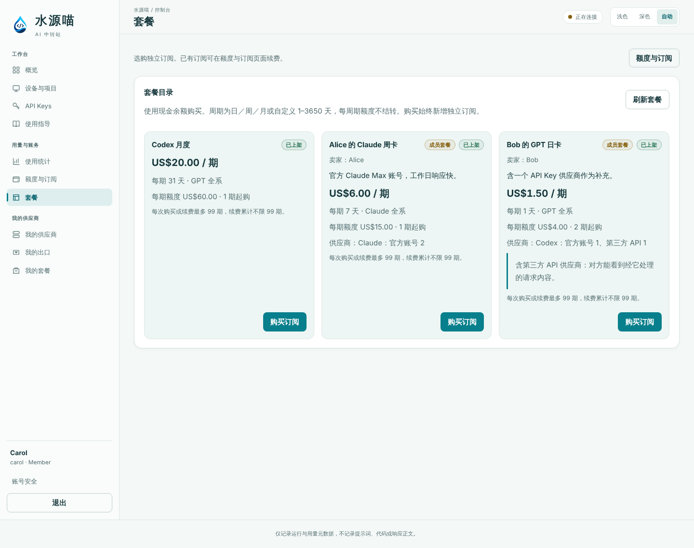
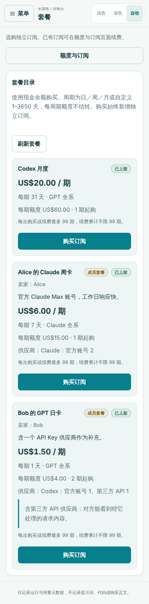
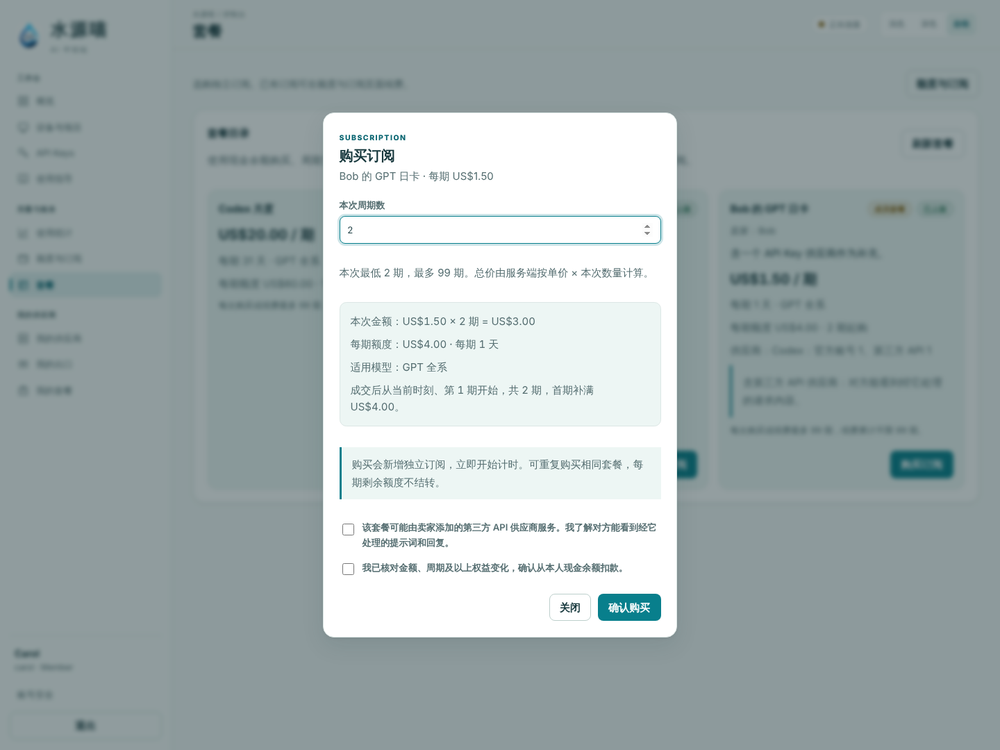
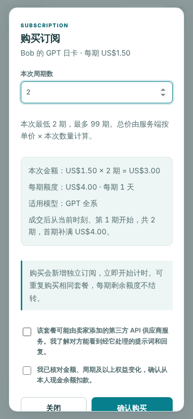
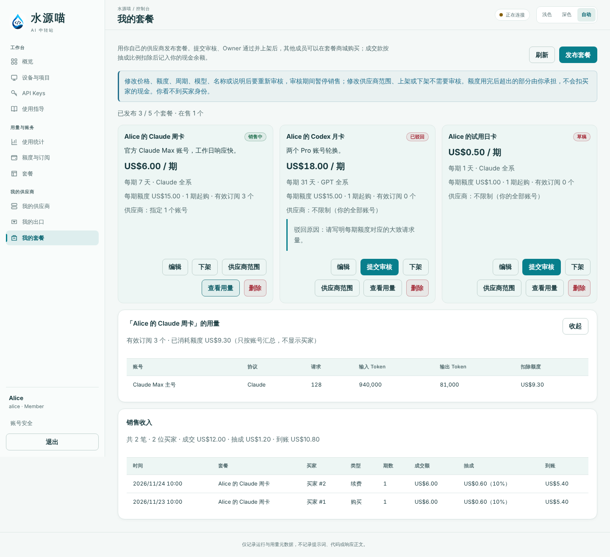
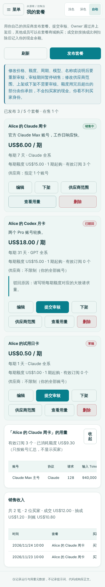
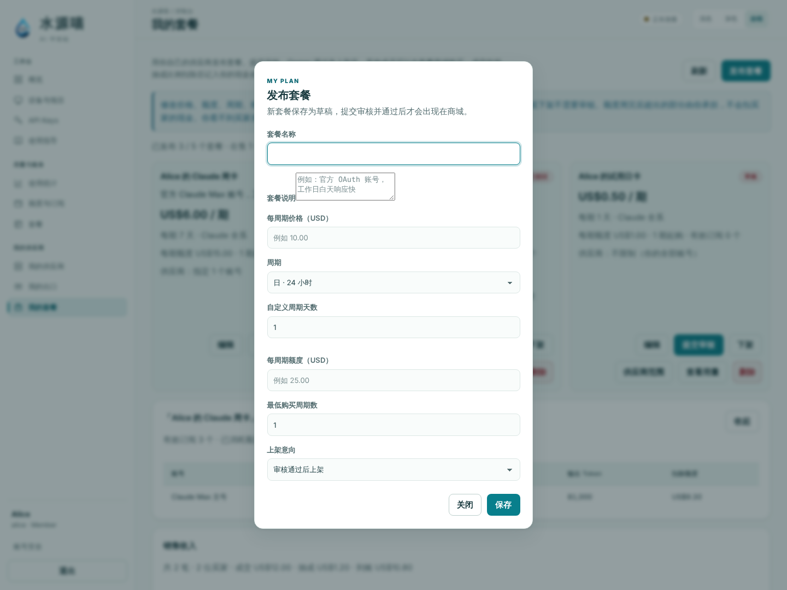
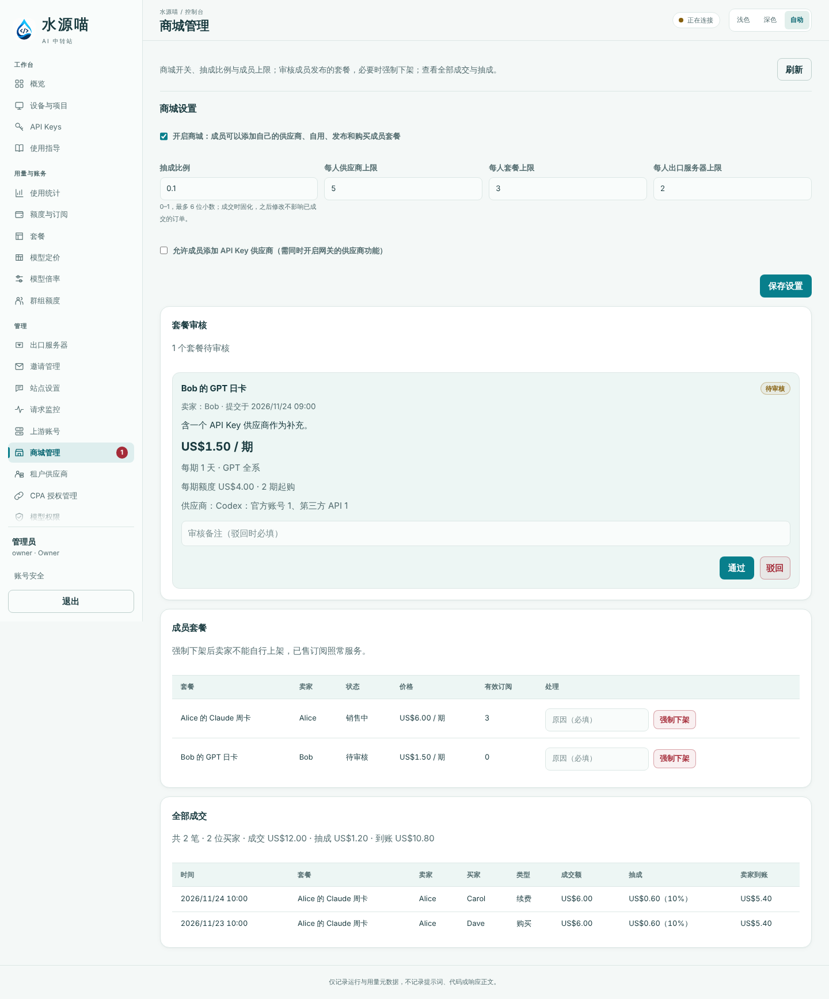
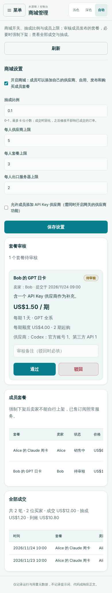

# 聚合网关阶段 4 验证：卖家套餐、审核、商城与分账

2026-11-25 完成[聚合网关改造计划](aggregation-gateway-plan.md)的阶段 4。成员可以发布用自己供应商服务的套餐，Owner 审核后上架销售，任何用户都能在套餐页用现金余额购买；成交款按抽成比例扣除后记入卖家余额。使用说明见[套餐商城](marketplace.md)。

功能由 `marketplace_settings.enabled` 控制，默认关闭。关闭时新路由全部返回 404，卖家套餐不能购买或续费；平台套餐的列表、购买、续费与升级前一致。本阶段只改 Gateway，不需要新的插件镜像。

## 本阶段采用的已确认取舍

2026-11-24 已确认，均按计划执行：

1. **买家匿名**：卖家只看到每个买家的顺序编号（买家 #N）、成交金额和按账号汇总的用量。
2. **审核范围**：修改供应商范围、上下架不需要审核，也不改变审核状态；修改价格、额度、周期、模型、名称、说明（以及起购期数）重新进入审核，审核期间停售，版本按现有规则提升。

计划未写明、实现时按“失败关闭、最小权限”处理的细节：

- 续费同样要求套餐已通过审核、未被下架、卖家正常、商城开启；下架（卖家自己的上架意向）不影响续费。
- 第三方 API 确认只针对卖家套餐中由成员添加的 API Key 供应商；平台供应商由 Owner 运营，平台套餐不要求确认。
- Owner 强制下架只停止销售，已售订阅照常服务；卖家用户被停用时，阶段 3 的规则已使其订阅层没有可用账号。
- 抽成为 100% 时卖家没有到账流水，成交记录照常写入。

## 行为

### 数据（迁移 `0054_marketplace.sql`）

- `billing_plans`：`review_status`（draft/pending/approved/rejected）、`review_note`、`reviewed_by_user_id`、`reviewed_at`、`submitted_at`、`description`（≤1000 字）、`admin_suspended`。现有套餐全部是平台套餐，状态为 approved；约束 `billing_plans_platform_approved` 保证平台套餐始终已通过、不能被下架。
- `marketplace_sales`：每笔卖家套餐的购买或续费一行，`operation_id` 唯一；成交额、成交时的抽成比例、抽成、净额（约束 `gross = commission + net`、买卖双方不同）、`buyer_number`、订阅、买卖双方的流水引用（`ON DELETE SET NULL`，不阻止信息清理）。
- 流水类型新增 `plan_sale_income`。

### 卖家套餐与审核

- 新套餐为草稿；数量上限 `max_plans_per_user` 在卖家账户锁内计数，已删除的不计。只有正常状态的成员能发布。
- 实质修改让已通过、已驳回、待审核的套餐回到待审核，`submitted_at` 更新；草稿保持草稿。上下架改变版本但不改变审核状态；被 Owner 下架的套餐不能重新上架（可以下架）。
- 提交只接受草稿和已驳回；审核只接受待审核，且版本必须等于审核时看到的版本；驳回必须写原因（≤500 字）。
- Owner 的平台套餐接口（列表、修改、删除）只作用于平台套餐，对卖家套餐返回“不存在”；卖家接口只作用于本人的套餐，他人的一律 404。
- 在售条件：未删除、已上架、（卖家套餐）已通过、未下架、卖家正常、商城开启。

### 购买、续费与分账

`transactBillingPlan` 在一个事务内完成：

1. 不加锁预读套餐的卖家（`seller_user_id` 不可修改），再按用户 ID 顺序锁定买家和卖家的账户；之后在锁内重新核对卖家，不一致返回“套餐已变化”。
2. 卖家套餐：禁止自购；不在售返回 `plan_not_on_sale`；范围内有成员 API Key 供应商且未确认返回 `third_party_acknowledgement_required`。
3. 照旧新增或续期订阅、扣买家现金、写买家流水。
4. 抽成 = 成交额 × 当时的比例，向下取整到 12 位小数；净额 = 成交额 − 抽成。净额为正时给卖家新建现金 lot，写 `plan_sale_income` 流水（不含买家、不记操作人），再写 `marketplace_sales` 和审计事件 `marketplace.plan_sold`。
5. 同一 `operation_id` 重复提交只执行一次；任一步失败整体回滚。

### 接口与界面

- 卖家：`/admin/me/plans`（增删改、`provider-scope`、`submit`、`listing`、`usage`）、`/admin/me/sales`；只对成员开放，Owner 得到 403。
- 商城：`GET /admin/market/plans`（平台套餐与在售卖家套餐，含卖家显示名、说明、各协议的官方账号与第三方 API 数量、`third_party_api`、`own`）。购买和续费接受 `acknowledge_third_party`。
- Owner：`/admin/market/reviews`（待审核与全部卖家套餐）、`POST /admin/market/reviews/{id}`、`PUT /admin/market/plans/{id}/suspend`、`/admin/market/sales`；成员得到 403。
- `/admin/state` 的 `marketplace` 增加 `max_plans_per_user` 和 Owner 的 `pending_reviews`。
- 界面：开关打开时套餐页即商城；成员“我的套餐”（含销售收入和用量）；Owner“商城管理”（商城设置、审核、成员套餐处置、全部成交，导航显示待审数量）。

## 测试

- `TestMarketplacePostgresIntegration`（store）：
  - 审核生命周期：草稿不能审核、提交、驳回必须写原因、通过后在售；上下架和供应商范围不改变审核状态与版本；改价格或说明回到待审核并停售；强制下架后不能重新上架。
  - Owner 的平台套餐函数看不到卖家套餐；其他卖家读写得到“不存在”；卖家可删除自己的套餐。
  - 套餐上限与开关关闭时不能发布。
  - 分账精确：单价 3.333333333333 × 3 期，抽成 10% → 抽成 0.999999999999、到账 9.000000000000；重复提交只成交一次；卖家流水无操作人、有现金 lot 且可以花；续费按续费时的 25% 计算并沿用买家编号；第二个买家得到编号 2。
  - 自购、未确认第三方 API、开关关闭、卖家被停用都被拒绝；余额不足时整体回滚，卖家余额不变、没有成交记录。
  - 并发：两个成员各 20 次互相购买无死锁，余额精确；同一操作并发 8 次只扣一次。
  - 套餐用量只对卖家本人可见。
- `TestMarketplacePlansHTTPPostgresIntegration`（server）：开关关闭时 404；成员与 Owner 的权限边界（403/404）；草稿、提交、审核（错误决定 400、版本不符 409）；商城对买家与卖家的 `own` 标记；自购 400；卖家的销售响应不含买家 ID 和用户名；Owner 的成交含双方；改价后回到审核并从商城消失；下架、强制下架后重新上架 409；删除；套餐上限 409；Owner 的平台套餐列表不含卖家套餐。
- 升级测试：阶段 3 的 `TestFundingRule5PostgresIntegration` 等回放测试不变并通过（购买对 0054 之前的结构按平台套餐处理）。
- `marketplace_ui_test.cjs`（9 项）：目录按角色合并、文案、成员加载商城与卡片提示、第三方确认、我的套餐与匿名销售、编辑器校验与未确认操作的重试沿用同一操作 ID、上下架/提交/用量、Owner 审核与下架、商城设置校验与待审徽标。
- `marketplace_browser.cjs`（Playwright，桌面 1440×1080 与手机 390×844）：成员商城与第三方确认（未确认时不发请求，确认后的请求体）、我的套餐与用量、发布对话框、Owner 商城管理与驳回请求体；无横向滚动、无页面错误。截图：

| 页面 | 桌面 | 手机 |
|---|---|---|
| 套餐商城（成员） |  |  |
| 购买确认（含第三方 API） |  |  |
| 我的套餐与销售收入 |  |  |
| 发布套餐 |  | |
| 商城管理（Owner） |  |  |

## 已运行检查

环境：Go 1.26.11、Node.js 22、Playwright（Chromium）、PostgreSQL 16（一次性本地数据库）。

```sh
gofmt -l .                       # 无输出
go vet ./...
go vet -tags=integration ./internal/store ./internal/server
go build ./cmd/gateway
env -u ANTHROPIC_BASE_URL -u CLAUDE_CODE_PROVIDER_MANAGED_BY_HOST go test -count=1 ./...
env -u ANTHROPIC_BASE_URL -u CLAUDE_CODE_PROVIDER_MANAGED_BY_HOST CGO_ENABLED=1 go test -race -count=1 ./internal/store ./internal/server ./internal/proxy
TEST_DATABASE_URL='postgres://…/gateway_test?sslmode=disable' \
  env -u ANTHROPIC_BASE_URL -u CLAUDE_CODE_PROVIDER_MANAGED_BY_HOST \
  go test -count=1 -tags=integration ./internal/store ./internal/server   # 新建的空数据库
(cd deploy/codex-compat/plugin && go vet ./... && go vet -tags e2e ./... && CGO_ENABLED=1 go test -race -count=1 ./...)
python3 -m unittest scripts.tests.test_cpa_plugin_deploy
env -u ANTHROPIC_BASE_URL -u CLAUDE_CODE_PROVIDER_MANAGED_BY_HOST \
  node --test internal/server/testdata/*_test.cjs                # 306 项：305 通过，1 项按设计跳过
node internal/server/testdata/marketplace_browser.cjs
node internal/server/testdata/plan_scopes_browser.cjs
node internal/server/testdata/billing_plans_browser.cjs
```

以上全部通过。

**未运行**：插件 e2e 和镜像构建（本阶段没有改动插件与 CPA）；`scripts/tests/test_lock_images.py` 需要镜像仓库工具（与本改动无关的已知情况）。

**已知与本改动无关的失败**：在设置了 `ANTHROPIC_BASE_URL` 和 `CLAUDE_CODE_PROVIDER_MANAGED_BY_HOST` 的执行环境中，`TestClientConfigurator` 的两个 Node 用例失败；去掉这两个变量后通过。
