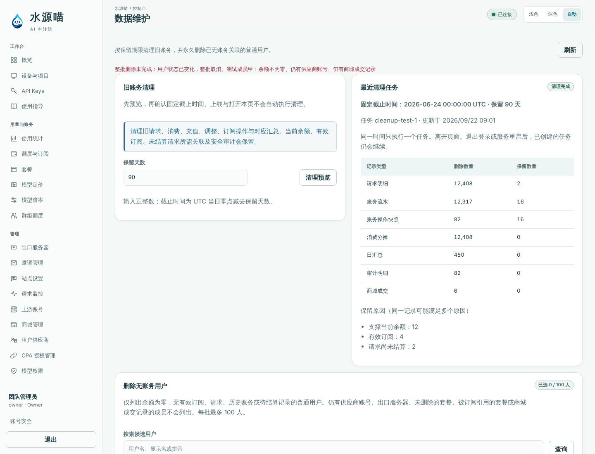

# 聚合网关阶段 5 验证：加固与文档

2026-11-25 完成[聚合网关改造计划](aggregation-gateway-plan.md)的阶段 5。本阶段让信息维护能够永久删除曾经拥有供应商或套餐的成员、让信息清理覆盖商城成交记录、增加两类告警，并把多租户的威胁分析、升级顺序和功能介绍补成完整文档。

功能仍由 `marketplace_settings.enabled` 控制，默认关闭。开关关闭时，本阶段唯一可见的变化是：信息清理报告多一行“商城成交”（没有成交时为 0），删除候选列表的说明文字更新。本阶段只改 Gateway，不需要新的插件镜像。

## 本阶段确认的取舍

计划没有写明、2026-11-25 向用户确认：

1. **已释放账号的历史归属**：永久删除成员时，其已释放账号保留记录和用量历史，清空主人并标记 `owner_deleted_at`。这些账号不服务任何请求，也不进入任何人（包括 Owner 的平台账号）的管理范围；以后有人登录同一上游账号时按认领处理。（未选的做法：等用量历史清理完再删除账号记录；或只清空主人，让它作为已删除的平台账号出现在 Owner 的列表中。）
2. **成交记录的保留期**：跟随信息清理。成交记录早于清理截止时间、且买家与卖家两条流水都已清理时，随同一次清理删除。（未选的做法：永久保留，买卖双方因此永远不能被永久删除。）

实现时按“失败关闭、最小权限”处理的细节：

- 成员仍持有凭据的账号、出口服务器、未删除的套餐、仍被订阅引用的套餐和成交记录都阻止删除，不自动清理：删除仍有凭据的账号记录会让 CPA 中的凭据变成无主账号，开关关闭时会被当作平台账号使用；删除出口服务器需要同步出口运行时。
- 成员自己修改自己的套餐会把 `billing_plans.updated_by_user_id` 设为本人，这不再算“管理操作关联”；这些套餐在删除成员时一并删除。
- `subscription_layer_empty` 对受限的平台套餐（Owner 指定了账号范围）同样生效，`seller_user_id` 为空。
- `billing_attribution_missing` 的规则 4 告警保持原去重键和标题，已打开的告警不受影响；规则 5 告警按实际结算方式分别去重。

## 行为

### 数据（迁移 `0055_tenant_user_deletion.sql`）

- `upstream_accounts.owner_deleted_at`：约束 `upstream_accounts_owner_deleted_released` 只允许它出现在没有主人、凭据已删除的账号上。
- 归属触发器 `guard_upstream_account_owner` 增加 `owner_deleted` 理由：只接受已释放账号变为无主且带标记；`claim`、`transfer` 的规则不变。
- 索引 `marketplace_sales_buyer_user_idx`，供删除检查按买家查找。

### 永久删除成员（`DeleteInformationUsers`）

- 新的阻止原因（候选列表与事务内复查使用同一组条件）：`providers`、`egress_servers`、`seller_plans`、`plan_subscriptions`、`marketplace_sales`。阻止时返回 409 `users_not_deletable` 和逐人原因，界面显示为“仍有供应商账号”等文字。
- 加锁顺序：信息维护锁 → 全局额度锁 → 账务账户 → 用户 → 用户名下的账号行。正在恢复该成员已释放账号的登录会等待删除事务，删除检查看到它的结果。
- 执行：已释放账号清空主人并写 `owner_deleted_at`；已删除且无人引用的卖家套餐随之删除（范围级联删除）；审计事件 `information.users.deleted` 增加 `released_account_ids` 和 `deleted_seller_plan_count`。
- 无主账号不出现在任何管理范围（`accountScopeSQL`），`UpstreamAccountOwnership.InScope` 对任何人都为否；结算判断服务账号是否属于成员时，无主账号按成员账号处理（不扣个人资金）。认领时清除标记（`changeUpstreamOwnerTx`、恢复已释放账号）。

### 信息清理

- 候选 `info_sales`：成交时间早于截止时间，且买家、卖家流水引用为空或在本批清理的流水中。成交记录先于流水删除。
- 清理报告的删除与保留计数增加 `marketplace_sales`（界面“商城成交”）；只有成交记录待删时也会执行一批。旧结构（没有 `marketplace_sales` 表）下跳过。

### 告警

- 准入时，受限订阅（启用、可扣费、覆盖所请求的模型、本周期仍有额度）解析出的账号池为空，该层照旧跳过，并记入 `BillingReservation.EmptySubscriptionLayers`；没有任何层时由 `NoUpstreamAccountError` 带出。Gateway 为每个订阅、每个协议产生一条 `subscription_layer_empty`（每次请求最多 8 条）。
- `BillingReservation.AllocationLayerKinds` 与 `AllocationGroups` 按下标对应，Gateway 转发时把层的种类放进 `AllocationGroup.Kind`（不上线路）。缺少归因且有用量时：只有群组和个人层的请求在多于一层时告警（不变）；含自用或受限订阅层时，只要有自用层或多于一层就告警，标题和 `details.fallback_layer` 说明结算方式（群组、受限订阅、个人，或记为未覆盖）。

### 文档

- `docs/threat-model.md`：完整的“多租户（聚合网关）”一节，取代阶段 2–4 的分段说明：参与方与信任、单一订阅者假设、第三方 API 供应商、恶意供应商与注入内容、OAuth 归属冲突、买卖双方的数据隔离、成员出口服务器、CPA 凭据数量增长、停用与永久删除、告警、剩余风险；数据生命周期补充成交记录和无主账号。
- `docs/operations.md`：聚合网关的完整升级顺序（备份 → 插件镜像 → 网关迁移 `0051`–`0055` → 打开开关）、成员的停用与永久删除（原因与处理方法）、聚合网关告警；更新阶段 4 中关于清理和删除的说明。
- README 的聚合网关介绍改为完整功能说明；`docs/tenant-providers.md`、`docs/marketplace.md`、`migrations/README.md` 同步更新。

## 测试

- `TestTenantUserDeletionPostgresIntegration`（store，新增）：
  - 仍有凭据的账号、出口服务器和未删除的套餐都给出原因，成员不在候选列表中，被拒绝的删除不改变账号；成员自己的套餐不算管理操作关联。
  - 只有已释放账号的成员可以删除：账号清空主人并带标记，不在平台账号列表中，`InScope` 对平台和其他成员都为否，审计记录账号；`owner_deleted` 理由不能用于仍有凭据的账号；另一成员登录同一账号时认领成功并清除标记。
  - 卖家已删除的套餐在历史清理后随卖家删除，范围一并删除。
  - 旧成交在买家订阅仍有效、卖家收入未用完时保留；订阅到期停用、收入用完后，清理删除成交记录并计入报告，卖家随后可以删除。
  - 成交后，卖家有 `plan_subscriptions`、`marketplace_sales`、`seller_plans`，买家有 `subscriptions`、`marketplace_sales`，互不混淆。
- `TestFundingRule5PostgresIntegration/a_paid_subscription_without_accounts_is_reported`（store，新增）：卖家账号可用时没有空层且层种类为自用、订阅、个人；卖家唯一账号释放后准入照常、空层列出订阅、套餐和卖家；再去掉自用账号和余额后，`NoUpstreamAccountError` 带出同一空层。
- `TestAttributionMissingAlert`、`TestEmptySubscriptionLayerAlerts`（server，新增）：规则 4 的单层和多层、无种类的旧层、只有自用层（记为未覆盖）、自用后群组／受限订阅／个人层、单个受限订阅层不告警；空层告警的去重键、标题、详情和每请求上限。
- `internal/server/testdata/information_browser.cjs`：删除被拒时显示“余额不为零、仍有供应商账号、仍有商城成交记录”，清理报告显示“商城成交”。
- 回归：`TestEmbeddedMigrationsCoverRequiredSchema` 改为 55 个迁移；回放旧迁移的辅助函数 `billingIntegrationTenantOwnershipSchema` 补上 `owner_deleted_at`。

## 已运行检查

| 命令 | 结果 |
| --- | --- |
| `gofmt -l .` | 无输出 |
| `go vet ./...`、`go vet -tags=integration ./internal/store ./internal/server` | 通过 |
| `go build ./cmd/gateway` | 通过 |
| `go test -count=1 ./...`（去掉 `ANTHROPIC_BASE_URL`、`CLAUDE_CODE_PROVIDER_MANAGED_BY_HOST`） | 通过，含 Node 驱动的界面测试 |
| `go test -race -count=1 ./...`（同上） | 通过 |
| `TEST_DATABASE_URL=… go test -count=1 -tags=integration ./internal/store ./internal/server`（新建的空 PostgreSQL 16 数据库） | 通过（store 139 s，server 133 s） |
| `(cd deploy/codex-compat/plugin && go vet ./... && go test -race -count=1 ./...)` | 通过（本阶段未改插件） |
| `python3 -m unittest scripts.tests.test_cpa_plugin_deploy` | 通过 |
| `python3 -m unittest discover -s scripts/tests -p 'test_*.py'` | 104 个用例中 28 个失败，全部是已知需要镜像仓库工具的 `test_lock_images` |
| `PLAYWRIGHT_MODULE=… node internal/server/testdata/information_browser.cjs` | 通过，无页面错误 |

插件 e2e 本阶段未运行：插件代码没有改动。

## 截图

由 `information_browser.cjs` 生成（桌面 1440 宽、手机 390×844）：

- `docs/screenshots/information-desktop.png`、`docs/screenshots/information-mobile.png`：清理报告的“商城成交”一行和删除候选列表的新说明。
- `docs/screenshots/information-deletion-blocked-desktop.png`：删除被拒时列出的成员原因。

## 未做的事项

- 阶段 4 留下的可选小项仍未做：Owner 平台套餐编辑器的“说明”字段、卖家可见的完整审核历史、退款流程。
- 成员已停用时，其出口服务器只能在重新启用后由成员删除；Owner 没有删除成员节点的入口。
- 删除候选列表只列出可删除的成员；要查看某个成员为何不能删除，只能在选择后的删除结果或数据库中查看。
