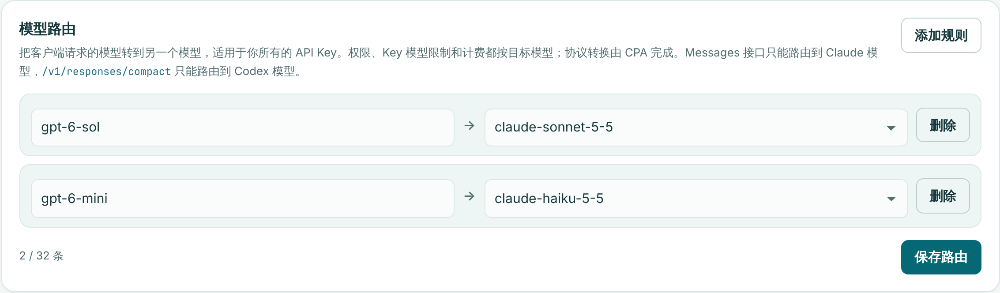
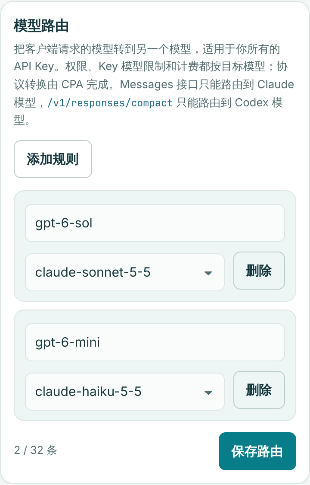

# 模型路由验证

2026-11-09 新增每用户模型路由表。用户在“API Keys”页维护规则，例如把 `gpt-6-sol` 路由到 `claude-sonnet-5-5`；命中后请求按目标模型准入、计价、扣费和转发。

## 行为

- **只改模型名，不做协议转换**：Gateway 在 `prepareModelBody` 落盘扫描请求体后查询路由，命中时只替换请求体顶层 `model` 字符串的字节，客户端协议原样交给 CPA。`/v1/responses` 到 Claude 模型由 CPA 的 `translator/claude/openai/responses` 转换，到 Codex 模型无需转换。
- **按目标模型校验和计费**：替换发生在任何权限、价格或提供方判断之前，因此用户模型权限、API Key 模型限制、价格快照、计费方式、扣费来源与倍率、Claude 账号池和降级判断都只看目标模型。`usage_requests.model` 是目标模型，`usage_requests.requested_model` 保留客户端请求的模型；控制台显示“请求模型 → 实际模型”。
- **适用范围**：
  - `/v1/responses`：可以路由到任意已开放的模型。
  - `/v1/messages`、`/v1/messages/count_tokens`：只能路由到 Claude 模型，因为 CPA 补丁对原生 Messages 固定使用 Claude 执行器。
  - `/v1/responses/compact`：只能路由到 Codex 模型。
  - 不兼容的组合在转发和扣费前返回 `400 model_route_incompatible`，错误信息写明原模型和目标模型。
  - Gemini 原生接口的模型在 URL 路径中，不参与路由。
- **失败即拒绝**：路由查询出错时返回 `503 model_route_unavailable`，不会按原模型继续转发。
- **规则约束**：
  - 每个用户最多 32 条规则，原模型不能重复，原模型不能与目标相同。
  - 目标不能再是另一条规则的原模型，所以路由只跳转一次，结果与规则顺序无关。
  - 保存时目标必须是该用户当前可用的模型；之后失去权限的目标在列表中标为“当前不可用”，命中的请求会被准入检查拒绝。
- **管理与审计**：
  - `PUT /admin/model-routes` 整表替换，需要同源请求和 5 分钟内的身份验证，每次保存写入 `user.model_routes_changed` 审计事件，记录前后规则。
  - Owner 不能修改他人的规则，但可以在请求监控中看到请求模型和实际模型。
  - 永久删除用户时一并删除其规则。
- **未改动**：
  - 响应不改写，客户端看到的是目标模型。
  - `/v1/models` 不列出路由别名。
  - CPA 补丁与镜像不变。

## 数据库

`0046_user_model_routes.sql` 新建 `user_model_routes`：
- 主键为 `(user_id, source_model)`，删除用户时级联删除。
- CHECK 约束限制模型名语法（与请求的 `validModel` 一致），并禁止原模型等于目标模型。
- 现有数据不变。

## 已运行检查

环境：Go 1.26.10、Node.js 22.23.4、PostgreSQL 16（UTF-8 数据库）、预装 Chromium。

```sh
gofmt -l .
go vet ./...
go vet -tags=integration ./...
go build ./cmd/gateway
git diff --check
go test -count=1 ./...
TEST_DATABASE_URL=... go test -count=1 -tags=integration ./internal/store ./internal/server ./internal/proxy
node --test $(ls internal/server/testdata/*.cjs | grep -v _browser.cjs)
SCREENSHOT_DIR=docs/screenshots node internal/server/testdata/model_routes_browser.cjs
python3 -m unittest discover -s scripts/tests -p 'test_*.py'
```

全部通过。说明两点环境问题：
- 云端会话会注入 `ANTHROPIC_BASE_URL` 等 Claude 环境变量，`TestClientConfigurator` 会因此拒绝写入并失败，改动前也一样。清除这些变量后再运行 Go 测试。
- 部分存储集成测试使用固定用户名，同一个数据库第二次运行会报 `conflict`。每次运行前请重建测试数据库。

新增或扩展的测试：

- `internal/store/model_routes_integration_test.go`：
  - 增删改与整表替换：未改动的规则保留创建和更新时间，未列出的规则被删除；
  - 按用户隔离；
  - 拒绝重复、自指、串联、非法语法和超过 32 条的规则，且拒绝后原有规则不变；
  - 审计事件；
  - 数据库约束兜底。
- `internal/server/model_routes_test.go`：
  - 请求体改写：模型在开头、中间、末尾，带空白，嵌套同名字段，以及超过 64 KiB 读缓冲、分块传输的大请求体；
  - 改写后的长度与读取计数一致；
  - 拒绝需要 JSON 转义的目标和已开始读取的请求体；
  - 查询失败返回 503；
  - Messages 和 count_tokens 路由到 Codex 模型返回 400；
  - 以上拒绝都不访问上游，也不产生额度预留。
- `internal/server/anthropic_integration_test.go`，在真实 PostgreSQL 上：
  - 控制台接口拒绝不可用目标和串联规则；
  - 保存 `gpt-alias → claude-test` 后，普通和流式 `/v1/responses` 以 `"model":"claude-test"` 原样协议到达模拟 CPA；
  - 使用记录为 `gpt-alias → claude-test`，提供方为 `anthropic`，计费方式为 Anthropic，费用按 claude-test 计价；
  - API Key 模型限制只包含目标模型，请求仍然通过；
  - 路由到 compact 返回 400，且不写入使用记录；
  - 清空规则后，同一请求因 Key 模型限制返回 403。
- `internal/server/testdata/model_routes_ui_test.cjs`：
  - 加载规则并标记不可用目标；
  - 整表保存、去除首尾空白、跳过空行；
  - 五类非法草稿在请求前被拒绝；
  - 使用记录的模型单元格。
- `internal/server/testdata/model_routes_browser.cjs`：使用合成数据完成加载、删除、添加、保存和重复校验，并生成截图；断言 390 px 宽度下无横向溢出、无页面错误。
- 既有测试中断言“只发生 API Key 认证查询”的三处，现在允许或过滤路由查询；它们断言的“无额度预留、无计费、无权限读取”保持不变。

## 截图





## 仍需目标环境验证

模拟 CPA 返回的 Responses 格式按 CPA v8.0.59 源码构造。上线后建议用真实账号，以 Codex CLI 请求一个路由到 Claude 的模型：确认流式输出正常，并核对使用记录中的请求模型、实际模型和费用。经 `/v1/responses` 调用 Claude 时，缓存写入仍按较高写入价保守计费，见 README。
