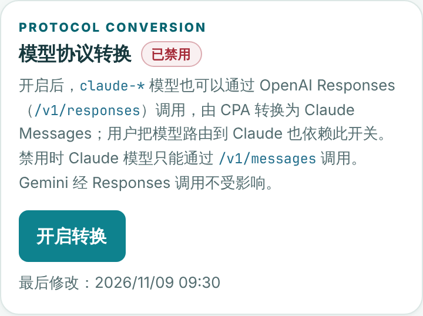

# 模型协议转换开关验证

2026-11-09 在 Owner 的“模型权限”页新增“模型协议转换”开关，默认禁用。

## 行为

- **管控范围**：开关只控制 `claude-*` 模型能否通过 OpenAI Responses（`POST /v1/responses`）调用。这条路径由 CPA 把请求转换为 Claude Messages，用户把模型路由到 Claude 也依赖它。
- **不受影响**：原生 `/v1/messages`、Codex 模型、Gemini 经 Responses 调用，以及不跨协议的模型路由。
- **默认禁用**：迁移 `0047_protocol_conversion_settings.sql` 写入的初始值为禁用。升级后行为与开放 Claude Responses 之前一致：Claude 模型只能通过 `/v1/messages` 调用，直到 Owner 开启。
- **禁用时**：请求在额度、使用记录和计费之前被拒绝，也不会到达 CPA。
  - 直接请求返回 `400 protocol_conversion_disabled`。
  - 经模型路由命中 Claude 的请求返回 `400 model_route_incompatible`，错误信息写明原模型、目标模型和“管理员未开启模型协议转换”。
- **失败即拒绝**：开关读取失败时返回 `503 protocol_conversion_unavailable`。开关只在 Claude 经 Responses 的请求上读取，其他请求不增加数据库查询。
- **修改权限**：
  - 只有 Owner 可以读取和修改：`GET`/`PUT /admin/protocol-conversion`。修改需要同源请求和 5 分钟内的身份验证。
  - 请求必须带上页面读取时的 `revision`；版本已变化时返回 `409 protocol_conversion_revision_changed`，页面随即刷新为最新状态。
  - 每次修改写入 `gateway.protocol_conversion_changed` 审计事件（`warning` 级别），记录修改前后的值。
- **界面**：
  - 禁用操作会先弹出确认，提示新请求会立即被拒绝。
  - 普通用户的“模型路由”卡片在开关明确为禁用时显示提示，用户只能查看、不能修改。

## 已运行检查

环境：Go 1.26.10、Node.js 22.23.4、PostgreSQL 16（每轮重建的 UTF-8 数据库）、预装 Chromium。

```sh
gofmt -l .
go vet ./...
go vet -tags=integration ./...
go build ./cmd/gateway
git diff --check
go test -count=1 ./...
TEST_DATABASE_URL=... go test -count=1 -tags=integration ./internal/store ./internal/server ./internal/proxy
node --test $(ls internal/server/testdata/*.cjs | grep -v _browser.cjs)
SCREENSHOT_DIR=docs/screenshots node internal/server/testdata/protocol_conversion_browser.cjs
node internal/server/testdata/model_access_batch_browser.cjs
node internal/server/testdata/model_routes_browser.cjs
python3 -m unittest discover -s scripts/tests -p 'test_*.py'
```

全部通过。运行 Go 测试前需要清除云端会话注入的 `ANTHROPIC_BASE_URL` 等变量，否则 `TestClientConfigurator` 会失败，与本次改动无关。

新增或扩展的测试：

- `internal/store/protocol_conversion_integration_test.go`：
  - 列默认值为 `false`；
  - 切换后版本加一，读回一致；
  - 旧版本返回 `ErrConflict`，缺少操作者返回 `ErrInvalid`；
  - 写入审计事件。
- `internal/server/protocol_conversion_test.go`：
  - 禁用时直接请求和路由请求被拒绝；
  - 读取失败返回 503；
  - 开启后请求通过开关，继续进入定价检查；
  - 原生 Messages 和 Codex 模型请求从不读取开关；
  - 以上情况都不访问上游，也只有 API Key 认证一次数据库查询。
- `internal/server/anthropic_integration_test.go`，在真实 PostgreSQL 上：
  - 默认禁用时请求被拒绝，且不写使用记录；
  - 普通用户读写接口返回 403；
  - 旧版本返回 409，非法值返回 400；
  - Owner 开启后，原有的 Claude 经 Responses 计费断言和模型路由断言照常通过；
  - 模型路由接口返回 `protocol_conversion_enabled: true`。
- `internal/server/testdata/protocol_conversion_ui_test.cjs`：
  - 默认显示禁用；
  - 开启不弹确认，并按读取的版本提交；
  - 禁用需要确认，取消时不发请求；
  - 版本冲突后重新加载；
  - 模型路由提示只在明确禁用时显示。
- `internal/server/testdata/protocol_conversion_browser.cjs`：
  - 在真实浏览器中完成默认禁用、开启、确认后禁用；
  - 校验两次提交的版本号；
  - 390 px 宽度下无横向溢出、无页面错误。
  - 这个脚本发现并修复了一个问题：按钮在提交期间由 `runButton` 托管，结束时会恢复点击前的文字，所以新状态的按钮文字必须写入 `dataset.idleLabel`。
- `model_access_batch_browser.cjs` 增加了开关的合成响应，因为“模型权限”页现在也会读取开关。

## 截图




## 升级提示

部署这个版本后，Claude 经 `/v1/responses` 的调用（包括目标为 Claude 的模型路由）会被拒绝，直到 Owner 在“模型权限”页开启“模型协议转换”。原生 `/v1/messages` 不受影响。
